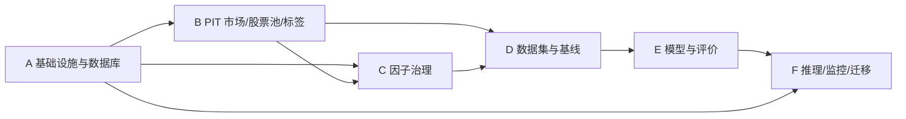

# Quant Research V2 Master Implementation Plan

> **For agentic workers:** REQUIRED SUB-SKILL: Use superpowers:subagent-driven-development (recommended) or superpowers:executing-plans to implement this plan task-by-task. Steps use checkbox (`- [ ]`) syntax for tracking.

**Goal:** 在不修改 `dfs://YesLab` 现有表结构的前提下，建设一套可复现、点时正确、以样本外 RankIC/ICIR 为核心、支持年度 walk-forward 与生产影子运行的 A 股量化研究 V2 平台。

**Architecture:** V2 以独立 Python 包 `research_v2` 和独立 DolphinDB 数据库 `dfs://QuantResearchV2` 作为 sidecar；V1/`dfs://YesLab` 全程只读。数据按 source → PIT clean → universe/label/factor → dataset manifest → baseline/model → evaluation/registry → shadow inference 的单向依赖流转，所有发布采用 staging + validation + atomic publish，并以 `run_id`、`data_version`、watermark 和 record hash 保证可追溯性。

**Tech Stack:** Python 3.11、DolphinDB Python SDK 3.0、Pandas/NumPy/PyArrow、scikit-learn、LightGBM、PyTorch 2.6、SciPy/statsmodels、Pydantic 2、Typer、YAML、pytest/Hypothesis、Ruff、mypy；DolphinDB TSDB 分区表；4×RTX 4090 用于受控训练。

---

## 0. 执行边界

本文件是批准规格的实施导航，不是实施授权。用户当前要求“先不要实际开发”，因此本轮只允许创建或修改 `docs/superpowers/plans/*.md`：

- 不连接 DolphinDB/Tushare；
- 不创建、删除或修改任何数据库、表、分区或用户；
- 不安装依赖，不运行迁移、训练、回测或推理；
- 不创建 `research_v2/` 业务代码；
- 不改动 V1 文件与 `dfs://YesLab`；
- 后续只有在用户明确授权实施后，才从 Task 1 开始执行。

批准的设计规格：[`2026-08-01-quant-research-v2-design.md`](../specs/2026-08-01-quant-research-v2-design.md)。规格优先于计划；如实施中发现冲突，先更新规格并重新批准，不在代码中暗自改变口径。

## 1. 计划包与依赖关系

| 顺序 | 子计划 | 产出 | 前置条件 |
|---|---|---|---|
| A | [`A：基础设施与数据库`](2026-08-01-quant-research-v2-a-foundation-database-plan.md) | 包骨架、配置、连接边界、迁移、控制表、发布事务 | 无 |
| B | [`B：PIT 市场、股票池与标签`](2026-08-01-quant-research-v2-b-pit-market-universe-labels-plan.md) | 市场清洗、SCD、可交易性、股票池、5 日标签、对账 | A |
| C | [`C：因子治理`](2026-08-01-quant-research-v2-c-factor-governance-plan.md) | 因子注册、去重、PIT、质量、相关簇、因子集 | A、B 的交易日历/股票池 |
| D | [`D：数据集与基线`](2026-08-01-quant-research-v2-d-datasets-baselines-plan.md) | 年度切分、训练内筛选、manifest、B0–B3、双重门槛 | B、C |
| E | [`E：模型与评价`](2026-08-01-quant-research-v2-e-models-evaluation-plan.md) | M1–M4、组合损失、训练器、OOS 评价、模型注册 | D |
| F | [`F：推理、监控与迁移`](2026-08-01-quant-research-v2-f-inference-monitoring-migration-plan.md) | 日频推理、水位、影子期、兼容导出、切换/回滚、锁箱 | A–E |



## 2. 目标代码树

实施时新增以下独立目录；不迁移、不重命名现有中文目录：

```text
research_v2/
├── pyproject.toml
├── README.md
├── configs/
│   ├── base.yaml
│   ├── dev.yaml
│   ├── test.yaml
│   ├── production.yaml
│   ├── universe/cn_liquid_a.yaml
│   ├── labels/forward_open_5d.yaml
│   ├── splits/annual_5y1y1y.yaml
│   └── models/{ridge,lgbm_ranker,residual_mlp,temporal,set_attention,economic_graph}.yaml
├── migrations/
│   ├── 001_control_tables.dos
│   ├── 002_pit_tables.dos
│   ├── 003_factor_tables.dos
│   └── 004_experiment_tables.dos
├── src/research_v2/
│   ├── cli/
│   ├── config/
│   ├── contracts/
│   ├── db/
│   ├── sources/
│   ├── pit/
│   ├── universe/
│   ├── labels/
│   ├── factors/
│   ├── datasets/
│   ├── baselines/
│   ├── models/
│   ├── training/
│   ├── evaluation/
│   ├── registry/
│   ├── inference/
│   ├── monitoring/
│   └── reporting/
├── tests/
│   ├── unit/
│   ├── contract/
│   ├── property/
│   ├── leakage/
│   ├── golden/
│   └── integration/
└── runbooks/
```

## 3. 不可变研究口径

实施者必须把以下规则写成配置、契约和自动化测试，不能只保留在文档里：

| 主题 | 固定口径 |
|---|---|
| 主标签 | T 收盘产生信号，T+1 复权开盘买入，T+6 复权开盘卖出，原始 5 日收益 |
| 复权开盘 | `raw_open * adj_factor`，同一标的内保持一致尺度 |
| 主指标 | 每日横截面 Spearman RankIC；年度/全 OOS 均值、标准差、ICIR、HAC t-stat |
| 股票池 | 沪深 A 股；排除北交所、ST、停牌、上市不足 252 交易日；近 20 日至少 15 日有效；剔除 ADV20 后 20% |
| walk-forward | 5 年训练 + 1 年验证 + 1 年测试；按年滚动；边界 purge 6 个交易日 |
| 正式历史区间 | 2013 年 warmup，2014 年起可形成正式样本；F01–F06 测试 2020–2025 |
| 锁箱 | 2026 年只允许无标签 SHADOW 推理；年末且 T+6 标签成熟后一次性 locked test |
| 双重门槛 | OOS RankIC ≥ 0.03 且 Newey-West/HAC t-stat ≥ 2.0 |
| 稳健性门槛 | ≥70% 测试年 RankIC 为正；相对最优简单基线平均 ΔRankIC ≥0.005；单年正贡献 ≤50% |
| 特征选择 | 仅训练窗内；BH FDR q≤0.10、5 年中至少 3 年同向、≥60% inner folds 为正；相关簇阈值 0.90 |
| 特征数量 | 目标 15–40，soft max 40，hard max 60 |
| 模型顺序 | B0/B1/B2/B3 → M1 Residual MLP → M2 GRU/TCN → M3 Set Attention → 条件式 M4 经济图 |
| 组合损失 | 0.60 IC + 0.30 pairwise ranking + 0.10 Huber；只允许验证集上的小离散权重集合 |
| 生产晋级 | `DRAFT → WALK_FORWARD_PASSED → SHADOW`；满 60 个有效影子日且锁箱成熟/获批后进入 `LOCKED_TEST_APPROVED → LOCKED_TEST_PASSED → PRODUCTION` |

## 4. 全局工程约束

### 4.1 数据库边界

- `dfs://YesLab` 连接对象必须是只读 adapter；所有写 SQL/DolphinDB script API 在类型和运行时同时拒绝该 URI。
- V2 生产库仅为 `dfs://QuantResearchV2`，集成测试库仅为 `dfs://QuantResearchV2Test`。
- 每张事实表至少携带 `run_id`、`data_version`、`created_at`、`source_watermark_id`、`record_hash`。
- 时间序列表使用月份日期分区 + `ts_code` 或 `factor_id` HASH 分区；实际 bucket 数只能在 Phase 0 容量检查后固化到迁移脚本。
- 发布必须先写 staging，完成行数、唯一键、空值、日期范围、hash 和水位校验后再原子切换；失败批次不可见。

### 4.2 点时与防泄漏

- 每条观测区分 `observation_date`、`available_date`、`signal_date`，并强制 `available_date <= signal_date`。
- 技术因子不跨日填充；基本面以 `ann_date` 后首个交易日可用，最长向前持有 180 个日历日，并记录 `stale_days`。
- 所有 scaler、winsorizer、imputer、feature selector、cluster representative 和超参数只在每折训练/验证范围拟合。
- Dataset Builder 在 locked 年份默认 fail closed；推理 Builder 只能生成无标签 SHADOW batch。

### 4.3 可复现性

- 每次运行固定记录代码 commit、配置 hash、输入 watermark、schema version、数据版本、随机种子和环境摘要。
- 对排序与并列值定义稳定 tie-break：`trade_date, score DESC, ts_code ASC`。
- 对重复数据：完全一致折叠；仅一条非空值时保留并打标；多个冲突非空值隔离，不使用 first/last 猜测。
- 模型 artifact 必须包含配置、特征顺序、预处理状态、state dict、签名、训练/验证范围、指标和依赖版本。

### 4.4 密钥与权限

- 任何计划和代码不得写入 DolphinDB/Tushare 明文凭据。
- 实施第一天轮换已经暴露过的凭据；本地从环境变量或受管 secret provider 读取。
- 日常研究身份无 V1 写权限、无 schema migration 权限；迁移使用独立受控身份。

## 5. 里程碑与退出门

### Task 1: Phase 0——资产盘点与基准冻结

- [ ] 记录 Python/DolphinDB/CPU/GPU/磁盘环境，不安装或修改环境。
- [ ] 输出 V1 表、分区、schema、主键候选、日期覆盖、行数、重复率和水位清单。
- [ ] 在只读模式复现现有模型和 B0 单因子短区间结果，形成“重构前”审计报告。
- [ ] 审核 DolphinDB 节点磁盘、内存、TSDB license 与分区上限，确定 HASH bucket 数。
- [ ] 轮换暴露凭据并验证 least-privilege 账户。
- [ ] 审批 Phase 0 报告后才允许执行 A 计划迁移。

**退出门：** `source_inventory.json`、容量计算、V1 baseline 报告和权限矩阵均经过人工批准；无数据库写入发生。

### Task 2: Phase 1——执行 A 基础设施与数据库计划

- [ ] 按 A 计划从测试先行完成包骨架、配置、连接边界、迁移和控制表。
- [ ] 在 `QuantResearchV2Test` 完成 migration up/idempotency/失败回滚验证。
- [ ] 在生产 V2 空库执行经批准的迁移，并冻结 schema version。

**退出门：** 所有 A 计划测试通过；程序性证明 V1 写入被拒绝；迁移可重复执行且无副作用。

### Task 3: Phase 2——执行 B PIT 市场/股票池/标签计划

- [ ] 回填 security SCD、market clean、tradability 和 universe。
- [ ] 回填主标签及辅助标签；执行泄漏陷阱与黄金样本核验。
- [ ] 使用 Tushare 做抽样对账，不自动覆盖主源。

**退出门：** 2013 warmup–2025 标签成熟日的覆盖、唯一性、PIT 和人工算例全部通过；2026 label publish 被锁。

### Task 4: Phase 3——执行 C 因子治理计划

- [ ] 将已有因子映射到 registry，不修改源表。
- [ ] 完成确定性去重、冲突隔离、PIT 可用日和质量快照。
- [ ] 计算训练内质量统计与相关簇，产生版本化 factor sets。

**退出门：** 已知重复因子与冲突样本被检测；任何隔离记录不会进入可发布因子视图。

### Task 5: Phase 4——执行 D 数据集与基线计划

- [ ] 固化 F01–F06 与 final fold 定义和 purge 边界。
- [ ] 生成 immutable dataset manifests。
- [ ] 完成 B0–B3，按验证集选出每折 `best_simple_baseline`。
- [ ] 计算完整 OOS RankIC/ICIR/HAC 与双重门槛报告。

**退出门：** 所有基线可用同一 manifest 重跑到允许误差内；2026 无法被普通评价命令打开。

### Task 6: Phase 5——执行 E 模型与评价计划

- [ ] 按 M1 → M2 → M3 顺序实现，每个模型先单元/性质测试再小数据 smoke test。
- [ ] 仅当 M3 稳定胜过最优简单基线并有有效经济图边时，批准 M4。
- [ ] 对每个候选执行受限超参搜索、3 seeds、年度 OOS 与基线增量检验。
- [ ] 只有全门槛通过者进入 `WALK_FORWARD_PASSED`。

**退出门：** 候选的结果含完整 manifests/artifacts/metrics；不存在只报告单段最好结果或 test 选模。

### Task 7: Phase 6——执行 F 影子、监控与迁移计划

- [ ] 启用水位驱动日频推理，缺源/脏数据 fail closed。
- [ ] 运行至少 60 个有效交易日 SHADOW，持续记录覆盖、漂移、分数分布和延迟。
- [ ] 兼容导出仅写 V2 新路径；V1 产物不覆盖。
- [ ] 演练 active pointer 切换和一键回滚。

**退出门：** SHADOW 无关键告警、交易日覆盖达标、切换/回滚演练通过；模型状态最多到 `SHADOW`。

### Task 8: Phase 7——2026 locked test 与生产晋级

- [ ] 等待 2026 年结束且最后一个 T+6 标签成熟。
- [ ] 由独立审批人生成一次性 unlock token，记录审计信息。
- [ ] 只执行一次预注册的 locked evaluation，不重训、不调参、不改特征。
- [ ] 通过者从 `LOCKED_TEST_APPROVED` → `LOCKED_TEST_PASSED` → `PRODUCTION`；失败者标记 `LOCKED_TEST_FAILED`。

**退出门：** locked test 的输入 hash、命令、操作者和结果不可变；任何失败均不得用 2026 反馈再次优化同一候选。

## 6. 统一验证矩阵

每个子计划都必须通过适用层级，不能用单一端到端 smoke test 替代：

| 层级 | 目的 | 默认命令 |
|---|---|---|
| 静态 | 格式、类型、未使用导入 | `ruff check src tests && mypy src` |
| 单元 | 纯函数、边界、状态机 | `pytest tests/unit -q` |
| 契约 | schema、源 adapter、artifact 签名 | `pytest tests/contract -q` |
| 性质 | 去重、日期、排序、幂等不变量 | `pytest tests/property -q` |
| 泄漏 | future perturbation、fit scope、locked year | `pytest tests/leakage -q` |
| 黄金样本 | 50 只股票×60 交易日人工真值 | `pytest tests/golden -q` |
| 集成 | V2Test 迁移、发布、重跑 | `pytest tests/integration -q -m integration` |
| 全量 | 全工程回归 | `pytest -q` |

预期：所有命令退出码为 0；测试数量在实施中固化到 CI，不在计划阶段臆造具体数量。

## 7. 提交与审查策略

当前工作区不是 Git 仓库，因此本轮文档无法在此目录提交。后续实施前应由用户决定：

1. 将当前目录初始化/连接到正式仓库；或
2. 在已确认的干净 worktree 中执行计划。

实施时每个 Task 至少一个独立提交；数据迁移、业务逻辑和测试不得混入不相关改动。建议提交格式：

```text
test(v2): add failing tests for PIT labels
feat(v2): implement PIT label builder
docs(v2): record locked-test runbook
```

每个子计划结束执行 `superpowers:requesting-code-review`；全工程完成声明前执行 `superpowers:verification-before-completion`。不得因测试环境不可用而把任务标记完成。

## 8. 批准规格追踪矩阵

| 规格章节 | 实施落点 | 核心验收证据 |
|---|---|---|
| 1 背景与目标 | Master 3/5/10，D8，E8 | OOS 与基线门槛报告 |
| 2 架构边界 | A2/A3，F7/F10 | V1 write guard 与平行不干扰测试 |
| 3 数据模型 | A5/A6/A7，E9 条件迁移 | schema contracts、迁移幂等、原子发布 |
| 4 PIT 数据流 | B1–B4，C2–C6，D2 | 水位、未来扰动、黄金样本 |
| 5 标签 | B5，D5 | T+1/T+6 人工算例与 raw RankIC |
| 6 防泄漏与锁箱 | D1/D4/D9，E3/E7，F9 | leakage canaries、one-shot audit |
| 7 Walk-forward/选因 | D1/D3 | F01–F06、purge、FDR/inner-fold artifacts |
| 8 Dataset/基线 | D4/D6/D7/D8 | immutable manifests、B0–B3 |
| 9 候选模型/训练 | E1–E7/E9 | model tests、≤30 trials、3 seeds |
| 10 评价/双门槛 | D5/D8，E8 | RankIC/ICIR/HAC、G1–G6 |
| 11 任务编排 | A8，B7，C5，D8，E8，F4 | CLI contracts、pipeline audit |
| 12 每日推理/监控 | F1–F6 | label-free manifests、60 日 evidence |
| 13 错误恢复/安全 | A2/A3/A7，F4/F5/F8/F10 | 脱敏、fail-closed、故障注入、回滚 |
| 14 测试体系 | 各子计划完成标准 | unit/contract/property/leakage/golden/integration |
| 15 实施阶段 | Master 5 + A–F 顺序 | 每 Phase 退出门 |
| 16 迁移/回滚 | F7/F8/F10 | 独立导出、CAS pointer、桌面演练 |
| 17 完成定义 | Master 10 | 工程、影子、生产三层状态 |
| 18 风险处置 | Master 9 + 各 DQ/gate | blocker 记录与停止条件 |
| 19 最终交付物 | Master + A–F docs/runbooks/reports | 文件清单、artifact manifest、交接材料 |

## 9. 风险登记与停止条件

| 风险 | 前置信号 | 缓解/停止条件 |
|---|---|---|
| V1 源 schema 漂移 | schema fingerprint 改变 | 停止物化，记录 DQ，先更新 contract |
| 大规模重复/冲突 | 唯一键冲突或 quarantine 激增 | 阻止 publish，不自动 first/last |
| 分区容量不足 | 单分区/节点估算超阈值 | Phase 0 重算分桶，迁移批准前解决 |
| 样本泄漏 | future perturbation 改变过去输出 | 阻止模型注册，修复后全量重跑 |
| 基线过强 | 候选 ΔRankIC <0.005 | 保留简单基线，不为复杂度找借口 |
| 年度不稳 | 正年份不足或贡献集中 | 不晋级；分析 regime，不改 test 后重跑 |
| locked year 被读取 | 普通身份访问 label/evaluation | 立即停止，审计并作废受污染候选 |
| 影子数据迟到 | watermark 未齐或 coverage 下降 | fail closed，不发布当日预测 |

## 10. 完成定义

完成状态分三层报告，避免把“平台代码完成”和“模型业绩通过”混为一谈。

### 10.1 平台工程完成

- [ ] A–F 的代码、schema、单元/契约/性质/泄漏/黄金/集成测试全部完成并通过代码审查；需要真实候选的运营步骤可以保留未执行证据，但其实现与 V2Test 演练必须完成。
- [ ] V1 全程未被修改，V2Test 与 V2 迁移均有审计记录。
- [ ] 2014–2025 F01–F06 OOS 评价可复现，B0–B3 齐全。
- [ ] runbooks、数据字典、模型卡模板、实验报告和运营交接材料齐全。

即使没有复杂候选通过，平台工程仍可判定完成；此时模型停留在 `DRAFT`，不得启动正式 SHADOW 或声称模型有效。

### 10.2 模型历史与影子验收完成

- [ ] 至少一个复杂候选通过历史 G1–G6，进入 `WALK_FORWARD_PASSED`。
- [ ] 经部署审批进入 `SHADOW`，并运行至少 60 个有效交易日，数据/分数监控和回滚演练通过。

### 10.3 模型最终生产验收完成

- [ ] 2026 locked test 在合法时间点按预注册只执行一次并通过。
- [ ] 独立生产审批完成，模型状态进入 `PRODUCTION`；在此之前不得声称最终生产模型通过。
